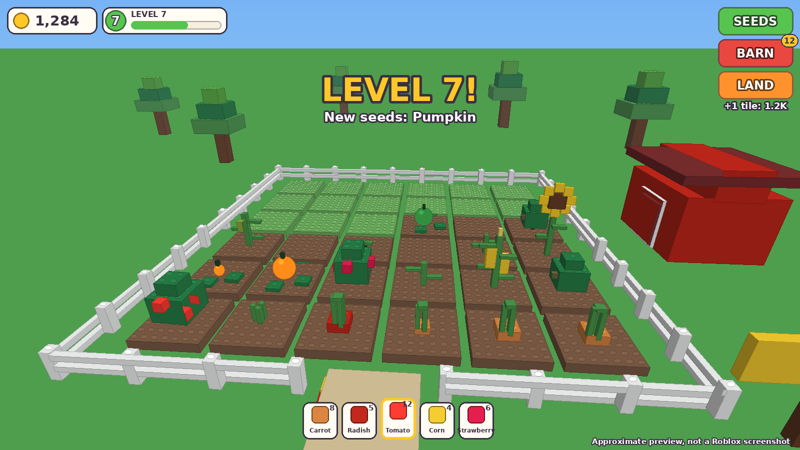

# Brick Farm: وثيقة الفكرة (بلا كود)

> **مهم:** هذي وثيقة فكرة فقط. ما كتبت حتى سطر كود. كل رقم هنا **فرضية** نتأكد منها بمحاكاة ثم بلاعبين حقيقيين، ماشي وعد بالربح.
> الاسم مؤقت: **Brick Farm**. الفرع: `claude/new-game`. التاريخ: 15 أكتوبر 2026.

---

## 1. الفكرة في 3 أسطر

**Happy Farm القديمة، مبنية كاملة بالبلوكات (أسلوب ليغو)، داخل قرية يتشاركها اللاعبين.**
تزرع محاصيل صغيرة مبنية بلوكة فوق بلوكة، تكبر بالوقت (حتى وأنت غايب)، تحصد وتبيع وتوسّع الأرض. وتزور مزارع الجيران: تعاونهم (يربحو الاثنين)، وفي الليل تقدر تغير عليهم بحدود عادلة والكلاب تحميهم.

**ليش هذي الفكرة؟**
- Happy Farm كانت من أنجح ألعاب الاجتماع في تاريخها، وفكرتها مفهومة في 5 ثواني.
- نوع "Grow a Garden" رجّع الزراعة للواجهة في Roblox. المنافسة فيه كثيرة، ومعظم النسخ **تنسى الجانب الاجتماعي** (كل لاعب لوحدو). هذي هي الفجوة.
- الأسلوب بلوكات: ما يحتاج رسم أو أنيميشن صعيب (شرطك)، ويقرا بوضوح من الهاتف.

## 2. اللي ما نعملوه (قيودك)

- بلا أنيميشن صعيب: النمو والتمايل والحصاد كلها حركات بسيطة (تكبير، ميلان، ارتداد، تفرق بلوكات).
- بلا حفر. نبات كامل بلوكات، وحيوانات بسيطة جدا (انظر القسم 7).
- **ادفع للراحة فقط**: كل شيء تشريه بالروبوكس تقدر تجيبو بالمجان بالوقت.

## 3. الحلقة الأساسية (أول 5 دقايق)

1. تدخل، **تلقى أرضك جاهزة** (4 مربعات تربة) وبذور في يدك. بلا قوائم.
2. تضغط على مربع → تنبت بزرة (بلوكة صغيرة تطلع من التربة، بحركة ارتداد).
3. النبتة تكبر قدامك في **30 ثانية** (الأولى) على 3 مراحل واضحة، ويجي صوت ولمعة لما تكون جاهزة.
4. تحصد: البلوكات تطير للحقيبة. تبيع عند الكشك: كوينز.
5. تشري بذور أحسن/مربعات أكثر. **لازم تكون أول عملية بيع في أول 60 ثانية** (قياس النجاح الأول).
6. في الدقيقة 3-5: تظهر لك قرية حواليك، فيها مزارع لاعبين آخرين، وسهم "زور الجيران".

## 4. التقدم (اللي يخلي اللاعب يرجع)

- **المستوى (XP)** مثل Happy Farm: كل محصول يعطي خبرة، كل مستوى يفتح محصول جديد أو أرض جديدة.
- **توسيع الأرض**: مربعات جديدة، وتربة تتحسن (عادية → غنية → ذهبية) وكل واحدة ترفع الإنتاج. هذا قلب الشعور بالتقدم المرئي.
- **المحاصيل بنوعين من الوقت**: سريعة (30 ث، للعب النشط) وبطيئة (ساعات، للغياب). اللي يلعب 5 دقايق في اليوم يربح، واللي يلعب ساعة يربح أكثر.
- **كتاب المحاصيل**: كل محصول وكل نسخة نادرة تتسجل (حب الجمع).
- **الطقس المشترك** (هذا اللي رفع Grow a Garden): أحداث في السيرفر كله، مثلا مطر (نمو أسرع) أو صاعقة (بلوكة ذهبية نادرة). نخليها قليلة ومفهومة، وتتزامن مع كل اللاعبين.
- **دخل وأنت غايب**: المحاصيل البطيئة تكمل. ترجع تلقى حصاد وهدية "مرحبا بيك".
- **المكافأة اليومية** لسبعة أيام، والغياب يوقّف السلسلة ما يمسحها.

## 5. الاجتماعي (هنا الفرق عن النسخ الأخرى)

**القرية المشتركة:** كل السيرفر (حتى 12 لاعب) في قرية واحدة، المزارع حوالين ساحة. تشوف جيرانك يزرعو بالوقت الحقيقي.

1. **المساعدة (دايما مربحة):** تسقي أو تنظف مزرعة جار → هو يربح نمو أسرع وأنت تربح كوينز وخبرة. هذا هو التفاعل الأساسي، وما فيه ضرر.
2. **الغارة الليلية (اختيارية، بحدود):** كل ليلة قصيرة في اللعبة تقدر تأخذ حبات من مزرعة جار، **مع حماية:**
   - حد أقصى 10% من محصول الجار في الغارة، ومرة واحدة لكل لاعب في الليلة.
   - **الجار يتعوّض ويتنبه** ("سرقك فلان، لقيت X تعويض").
   - اللاعبين الجدد (قبل مستوى 5) محميين.
   - **كلاب الحراسة** تقلل النجاح، وتقدر تفعّل "وضع آمن" بالمجان في الإعدادات (الغارة تتعطل على مزرعتك).
   - هذا يعطي حماس Happy Farm الأصلي بلا ما يزعج اللاعبين الصغار.
3. **سوق الجيران**: تبادل بسيط للمحاصيل العادية بين اللاعبين (بلا ندرة تتباع بالروبوكس، لتفادي مشاكل السياسة).
4. **معرض الأسبوع (Brick Fair):** كل أسبوع اللاعبين يصوتو على أحسن مزرعة. الفائز يتحط اسمو في الساحة ويربح زينة حصرية.

## 6. المظهر (ليغو، واضح بزاف)

- كل شيء بلوكات بلاستيك بحدود نظيفة وألوان صافية: تربة، نبات، سياج، كشك، بيت، كلب.
- **نهار فاتح ومشرق** (عكس Cubedash الليلية): السماء زرقاء، الألوان مشبعة، ظل خفيف.
- كل نبتة **تقرا من بعيد** بشكلها وألوانها (طماطم حمراء، ذرة صفراء...). النضج واضح: تلمع وتتحرك أكثر.
- **الحركة الطبيعية بدون أنيميشن صعيب:**
  - النمو: تكبير بنعومة مع ارتداد في الآخر.
  - الهواء: تمايل خفيف للنباتات.
  - الحصاد: البلوكات تتفرق بسرعة وتجري للحقيبة.
  - الأمطار/الصاعقة: جسيمات وإضاءة.
- **كل المحاصيل تتولّد من وصفات بسيطة**: كل نبتة = وصفة من بلوكات (شكل + لون)، فنزيد 30 محصول بدون رسم. هذا يخليني أبني بجودة وسرعة.

## 7. الحيوانات: حل وسط

عبّرت قبل أنك ما تحبش الحيوانات لأنها صعبة. الحل:
- **بقرة ودجاجة ممكنة، بلوكات ثابتة بحركة بسيطة** (تحرك الراس، تتمايل، تتنقل في دائرة صغيرة). **بلا مشي بأرجل واقعي.**
- الدجاجة تعطي بيض كل فترة، البقرة حليب. فيها وظيفة واضحة، ما تنزادش لدعايتها وبس.
- **كلب الحراسة**: بلوكات، يقعد في مزرعتك ويحميها من الغارات. يتحرك راسو وذيلو فقط.
- تكون **المرحلة 2** بعد ما نتأكدو أن الزراعة وحدها ممتعة.

## 8. الروبوكس (ادفع للراحة فقط)

كل واحد تقدر تجيبو بالمجان بالوقت:

| النوع | الاسم | اللي يعطي |
|---|---|---|
| Pass | Auto Harvest | يحصد تلقائيا (بدل ما تضغط كل مربع) |
| Pass | 2x Coins | البيع ×2 |
| Pass | Fast Grow | النمو أسرع بنسبة معينة |
| Pass | Extra Land | مربعات إضافية من البداية (نفس اللي تفتحه بالمستوى) |
| Pass | VIP | مظهر ذهبي + زينة مخصصة |
| Product | بوست نمو 30 د | مطر خاص لمزرعتك |
| Product | حزمة كوينز | دقايق من دخلك الحالي |

**ما نبيعوش:** بلوكات نادرة بالروبوكس، ولا حظ مدفوع (مشاكل السياسة وثقة اللاعبين).

## 9. ليش ممكن ينجح، وليش ممكن يفشل (بصراحة)

**نقاط القوة:**
- فكرة مجربة تاريخيا، قابلة للفهم الفوري.
- الجانب الاجتماعي ناقص في المنافسين.
- الأسلوب ليغو يقرا من الهاتف ويتبني بسرعة ويدوم.
- اللعبة تشتغل **ولو السيرفر فارغ** (المزرعة تتلعب لوحدها)، وهذا مهم لأي لعبة جديدة بلا لاعبين.

**المخاطر (هنا الصراحة):**
- **المنافسة**: نوع Grow a Garden مزدحم، وأكبر ألعابو نزلت من ملايين لعشرات الآلاف. **دخول أحسن 100 غير مضمون**، وهدف 500 ألف دولار في السنة يحتاج حظ وتسويق ورعاية مستمرة.
- **الغارات** يمكن تزعج اللاعبين. صممتها بحدود وحماية ووضع آمن، وتتجرب بسرعة (أول 20 لاعب).
- **التحويل من الجزائر**: سحب الأرباح (DevEx) وحجب Roblox في الجزائر ما تأكدناش منهم. لازم نتأكد قبل ما نستثمر وقت كبير.
- **الشكل والحركة** ما نقدرش نشوفهم، لازم تجربهم أنت في Studio.

## 10. خطة البناء (إذا وافقت)

1. **الأساس:** مزرعة، زراعة، نمو بالوقت، حصاد، بيع، حفظ. مع اختبارات (نمو، غياب، اقتصاد). ملف تجربو في Studio.
2. **الإحساس:** الحركة (نمو، تمايل، حصاد)، الإضاءة، الأصوات، 10 محاصيل.
3. **المستوى والأرض:** XP، توسيع الأرض، التربة، كتاب المحاصيل.
4. **القرية:** مزارع اللاعبين، الزيارة، المساعدة.
5. **الغارات والكلاب:** بالحدود والوضع الآمن.
6. **الروبوكس:** الـ passes والمنتجات (بـ id = 0 للتجربة المجانية في Studio).
7. **الطقس والمعرض.**
8. **الحيوانات (مرحلة 2).**

كل مرحلة: اختبارات تعدي، commit، ملف يتبعت لك مع صورة تقريبية (مش لقطة Roblox).

## 11. القرارات اللي لازم تؤكدها

1. **الاسم والمظهر:** Brick Farm بأسلوب ليغو نهاري مشرق. ماشي؟
2. **الغارات:** بالحدود والحماية اللي فوق، ولا نبعدوها؟
3. **الحيوانات:** مرحلة 2 (مقترحي) ولا من البداية؟
4. **مين يبدا:** أنا (Sonnet 5.5) ولا تحب تستعمل نموذج آخر للبناء؟

---

## ملحق: كيف نقيس النجاح من أول يوم (من قواعد ترتيب Roblox)

- **60 ثانية الأولى:** أول بيع. اللي ما باعش يخرج (bounce).
- **اليوم الأول (D1):** يرجع للحصاد (المحاصيل البطيئة + الهدية).
- **اليوم 2-7 و 8-28:** الأحداث الأسبوعية، المعرض، الجيران.
- نجرّب بـ 20-50 لاعب قبل ما نصرف على الإعلانات.

---

## المرحلة 1: مبنية (15 أكتوبر 2026)



**واش فيها:**
- قرية فيها 8 مزارع حوالين ساحة بنافورة، أشجار بلوكات، طرقان. كل لاعب ياخذ مزرعة، واسمو يبان على اللافتة.
- 10 محاصيل (من جزر 30 ثانية حتى ذرة ذهبية 8 ساعات)، كل وحدة مبنية بلوكات وتكبر على 4 مراحل.
- الحركة: كل مرحلة جديدة "تنفخ" بارتداد، النباتات تتمايل مع الريح، والجاهزة تتنطط. عند الحصاد البلوكات تطير لعندك.
- زراعة وحصاد بالضغط على المربع، أو **بالسحب فوق عدة مربعات** مرة وحدة.
- الحظيرة (Barn) للبيع، محل البذور (Seeds)، شراء الأرض (Land)، المستوى والخبرة، وإرشادات أول دقايق.
- المحاصيل **تكبر وأنت غايب**، وكي ترجع تقولك واش واجد.
- لاعب مفلس ياخذ بذور بالمجان (باش ما يتبلوكاش).

**الأرقام (محاكاة):** أول بيع في 30 ثانية، المستوى 2 في دقيقة ونص، المستوى 5 في ~27 دقيقة. اللي يلعب 15 دقيقة مرتين في اليوم: اليوم 7 → مستوى 11 و20 مربع، اليوم 14 → مستوى 19 و29 مربع (مازال ما كملش).

**الاختبارات:**
```
lune run tests/brickfarm.luau           # القواعد (156)
lune run tests/brickfarm_economy.luau   # الوتيرة (8)
lune run tests/brickfarm_flow.luau      # السيرفر (42)
lune run tests/brickfarm_ui.luau        # الشاشة والمزرعة في الهاتف (31)
rojo build brickfarm.project.json -o build/BrickFarm.rbxlx
```

**أوامر Studio في الشات:** `/grow` (كلشي يولي جاهز)، `/coins 5000`، `/level 10`، `/tiles 20`، `/seeds corn 10`، `/help`.

**الجاية (المرحلة 2):** مساعدة الجيران (سقي)، الغارات بالحدود، الطقس، الروبوكس للراحة، المكافأة اليومية، ثم الحيوانات.
