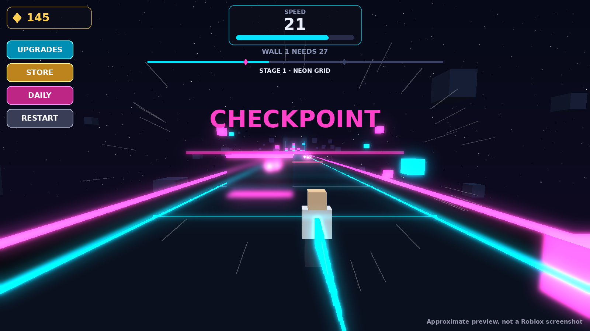

# Cubedash: لعبة الجري والسرعة (مثل +1 Speed Keyboard Escape)

> التاريخ: 15 أكتوبر 2026. الفرع: `claude/new-game`.
> **مهم:** كل الأرقام هنا من محاكاة (tests)، ماشي من لاعبين حقيقيين. الإحساس الحقيقي (السرعة، الكاميرا، الصعوبة) لازم يتجرّب في Roblox Studio.



## 1. اللعبة في سطرين

تجري في ممر مضيء وسط الليل. تجمع **الكرات المضيئة**، وكل كرة تزيدك **سرعة للأبد**. تتفادى العقبات اللي تولّي أصعب في كل مرحلة. وفي آخر كل مرحلة كاين **حيط من المكعبات**: إذا سرعتك كافية تكسّرو وينفجر مكعبات، وإذا ما كفاتش ترجع تجري المرحلة وتجمع كرات أكثر.

## 2. الحلقة (اللعب)

1. تبدا في المرحلة 1 (سرعة المشي 18 تقريبا).
2. الكرات ترجع في كل جرية جديدة للمرحلة. الكرة تعطي سرعة + كوينز.
3. **العقبات**: 5 أنواع، كل نوع يدخل في مرحلة:
   - المرحلة 1: **Sweeper** (حاجز يتحرك يمين ويسار) و**Laser** (شعاع أحمر تنقز عليه، يومض قبل ما يشعل).
   - المرحلة 2: **Spinner** (ذراع يدور).
   - المرحلة 3: **Falling cubes** (مكعبات كبار تطيح في عمودين من ثلاثة، وواحد ديما فارغ).
   - المرحلة 4: **Pendulum** (كرة معلّقة تتأرجح).
4. إذا ضربتك عقبة: **تنفجر مكعبات** وترجع لآخر **Checkpoint** (كاين 2 في كل مرحلة). السرعة اللي جمعتها ما تضيعش.
5. في الحيط: إذا سرعتك ≥ اللي يطلبها الحيط → **SMASH!** (المكعبات تطير + الشاشة تهتز + كوينز)، وتدخل المرحلة الجاية بلون وثيم جديد.
6. بعد المرحلة 10 → **Rebirth**: تبدا من جديد، بصح كل كرة وكل كوين يسواو +25% للأبد.

## 3. الأرقام (من المحاكاة)

| المرحلة | الحيط يطلب | سرعة المشي | الطول | الثيم |
|---|---|---|---|---|
| 1 | 27 | ~18 | 700 | Neon Grid |
| 5 | 15K | ~35 | 1200 | Violet Void |
| 10 | 3.3M | ~50 | 1830 | Prism |

- **أول مرة تكمّل الـ 10 مراحل: ~50 دقيقة** (المرحلة 1 من أول جرية، بعدها 2 → 6 جريات لكل مرحلة).
- أول Rebirth: ~15 دقيقة بعد ما تكمّل.
- بعد كل Rebirth المسار يولّي أسرع (40 دقيقة بدل 50).
- **الصعوبة** (بوتات تلعب مثل البشر، 20 جرية لكل مرحلة):

| | المرحلة 1 | المرحلة 5 | المرحلة 10 |
|---|---|---|---|
| لاعب قوي | 100% | 90% | 75% |
| لاعب عادي | 90% | 70% | 35% |
| مبتدئ | 75% | 30% | 10% |

(النسبة = كم مرة يكمّل المرحلة كاملة بلا ما يموت. مع الـ checkpoints يولّي أسهل بزاف.)

## 4. الروبوكس: **ادفع للراحة فقط**

كل شيء تقدر تجيبو بالمجان بالجري:

| النوع | الاسم | السعر (مؤقت) | واش يدير |
|---|---|---|---|
| Pass | 2x Speed | 399 | كل كرة سرعة ×2 |
| Pass | 2x Coins | 349 | الكوينز ×2 |
| Pass | Super Magnet | 199 | الكرات تجيك من ضعف المسافة |
| Pass | VIP | 499 | +25% كوينز |
| Product | Wall Breaker | 99 | السرعة اللي يطلبها الحيط تاعك، دركا |
| Product | 2x Coins 30 min | 79 | بوست |
| Product | Coin Pack S / L | 49 / 199 | 30 دقيقة / 3 ساعات من الكوينز تاعك |

الـ id تاع كل واحد = 0 حتى تصنعو في Creator Hub وتحطو في `cubedash/shared/Config/Passes.luau`. في Studio بـ id = 0 تاخذو بالمجان باش تجرّب.

## 5. الملفات

- `cubedash.project.json`: مشروع Rojo.
- `cubedash/shared/Logic/`: القواعد كامل (المراحل، العقبات، السرعة، الاقتصاد، التقدم). نفس الكود في السيرفر والهاتف.
  - `Stage.luau`: المرحلة تتبنى من رقمها برك (الكل يشوف نفس المسار).
  - `Obstacles.luau`: كل عقبة = معادلة على ساعة السيرفر (الكل يشوفها في نفس البلاصة).
  - `Economy.luau` و `Progress.luau`: الأسعار والمكافآت.
- `cubedash/server/`: بناء المسار (`CourseBuilder`)، التحقق من الكرات والحيط (`CourseService`)، الحفظ، الترقيات، الروبوكس، أوامر Studio.
- `cubedash/client/`: العقبات والكرات والحيط في الهاتف (`CourseController`)، الإحساس بالسرعة (`Effects`: الكاميرا تتوسّع، خطوط السرعة، الذيل المضيء، الاهتزاز)، الشاشة (`UI/`)، الإرشادات الأولى (`Guide`).

## 6. الاختبارات

```
lune run tests/cubedash.luau             # القواعد (151)
lune run tests/cubedash_economy.luau     # الوقت لكل مرحلة والـ rebirth (6)
lune run tests/cubedash_flow.luau        # السيرفر كامل (50)
lune run tests/cubedash_ui.luau          # الشاشة والمسار في الهاتف (39)
lune run tests/cubedash_difficulty.luau  # البوتات والصعوبة (16، دقيقة ونص)
rojo build cubedash.project.json -o build/Cubedash.rbxlx
```

## 7. كيفاش تجربها

1. افتح `build/Cubedash.rbxlx` في Roblox Studio.
2. Game Settings → Security → **Enable Studio Access to API Services** (للحفظ). في Studio ما يتحفظ والو وتبدا بـ 500 كوين.
3. Play. أوامر في الشات: `/speed 5000`، `/stage 5`، `/coins 100000`، `/rebirths 2`، `/daily`، `/help`.

## 8. واش ما تأكدناش منو (لازم Studio)

- الإحساس بالسرعة والكاميرا (FOV 70 → 108).
- الأصوات: استعملت أصوات Roblox المدمجة (`rbxasset://sounds/...`). يمكن نبدلوهم بأصوات أحسن.
- الحماية من الغش: السيرفر يتأكد من المكان قبل ما يعطي كرة أو يكسر حيط، بصح ما يتأكدش إذا اللاعب فات من العقبات (العقبات في الهاتف). هذا يأثّر غير على الغشاش وحدو.
- الأداء في الهواتف الضعيفة: العقبات تتحرك غير في المرحلة الحالية والجاية، وغير اللي قراب (260 stud).
