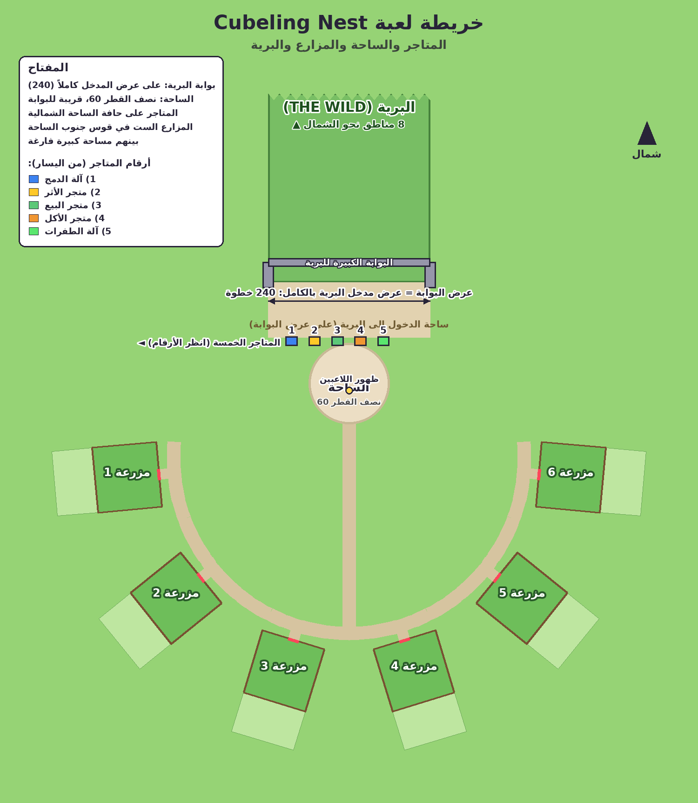
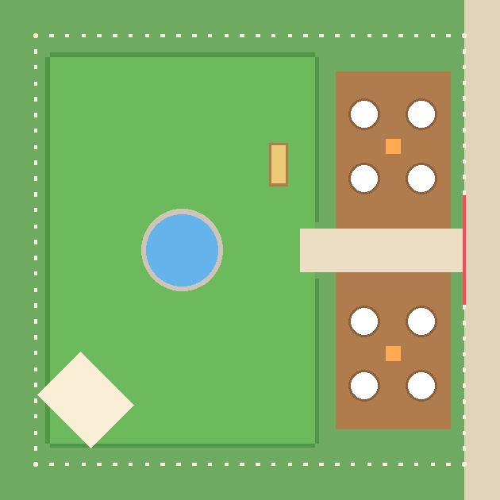

# Cubeling Nest

الكود في `game/` (يتبنى في Roblox بـ `default.project.json`).

## الماب
- **ساحة مدوّرة مبلّطة** (نصف قطرها 55) وين يظهرو اللاعبين، وحولها **عشب مفتوح** من كل جيهة (ميدان القتال والسرقة). طريق مبلّط وسطي (28 بلاصة) يمشي من الساحة لبوابة البرية، وبين الساحة والحدائق بلاصة خضراء كبيرة.
- **المحلات:** **4 بنايات في صف مستقيم مع البوابة**، اثنين من اليسار واثنين من اليمين برا أبراجها، **وجوههم للساحة** (على **ساحة مستطيلة مبلّطة** بعرض 430 بلاصة قدّام البوابة): **Shop** (بيع + ماكلة) وFuse Machine في اليسار، وTrail Shop وMutation Machine في اليمين. كل بناية فوق منصة حجر، فيها جدار خلفي وجداري جنب بشبابيك، سقف بإفريز ملون وحافة مقوّسة، فوانيس، حاويات ورد، كاونتر بحزام ملون (تقرب وتضغط **Open**) ورفوف سلع، والبنايات كبيرة (×1.35)، و**لوحة قائمة (MENU)** كبيرة معلّقة في السقف فوق الكاونتر (ولآلتين لوحة على الجنب) تكتب واش يباع فيها، واسمها بحروف كبيرة صفراء تطفو فوقها (🛒 **SHOP**، ✨ **TRAILS**...) بلا لوغوات.
- **Heist Egg** تطيح جنوب السباون.
- **في وسط الفوق:** الطريق المبلّط الوسطي يوصل من الساحة لـ **البوابة الكبيرة 🌿 THE WILD** (برجين وقوس على عرض مدخل البرية كامل: 240 بلاصة، 400 بلاصة شمال وسط المدينة)، والبرية ماب منفصلة وراها.
- **التحت (الجنوب):** **6 حدائق** جنب بعض في قوس، أبوابهم يشوفو للساحة، وطريق قوسي يفوت قدّام كامل الأبواب. كل لاعب في السيرفر ياخذ حديقة.
- **بلا ديكور زايد** باش ما يكونش lag.
- **كل حديقة** (80×80) دايرين بيها سياج خشب، وفيها **بوابة ليزر** تشوف للساحة. البوابة مفتوحة ديما لصاحبها، ومسكّرة على الآخرين.
  - **أفاتار صاحب الحديقة واسمو** يبانو فوق الحديقة في الفوق بزاف (60 بلاصة) بحروف صفراء كبيرة، باش يتشافو من بعيد ('OwnerBanner').
  - **ترتيب الحديقة من الباب للور:** (1) **الحوش قدّام الباب:** الفقاسات على اليسار تاع الطريق، والمخزن والمذود على اليمين. (2) **ساحة الفقس:** من سياج لسياج، للبيض برك وديما فارغة (ماشي في الطريق). (3) **الحضيرة (Pen):** في اللور من سياج لسياج، **عمقها ضعف ساحة الفقس** (الحديقة أطول من عرضها بـ40)، قدّامها سياج خشب: كل مخلوق يفقس يدخل ليها **وحدو** ويبقى فيها (إلا كانت عامرة يروح للـ inventory). فوق الباب اسم صاحب الحديقة.
  - **البيض في الحشيش (كيما Steal an Egg):** البيضة تبان في **الـ inventory (hotbar)** كأداة، كل نوع وحدو ("Meadow Egg ×3"). تهزها في يدك وتضغط، وتتحط **قدّامك في ساحة الفقس** في **عش من التبن** (كيما Steal an Egg) (برك، ماشي في الحضيرة ولا الحوش)، وتفقس **بالسرعة العادية**. ما تقدرش تحطها لاصقة في بيضة أخرى، ولا فوق المذود ولا المخزن ولا الفقاسات. وفي الـ 🎒 Bag كاين زر **Set down here** لكل نوع (يدير نفس الشي)، وزيد الأدوات ترجع وحدها بعد كل respawn.
    - **شحال من بيضة في الحشيش:** 3 بلاش، وتزيد بلايص من الشكارة (**+1 egg**) حتى 16.
    - البيضة المجانية الأولى تبدا محطوطة قدّام الباب.
  - **الفقاسات ⚡ في الحوش قدّام الباب (يسار الطريق):** 4 ماكينات بقبة زجاج، تشريهم وحدة وحدة (🪙 500K، 25M، 1B، 50B). البيضة فيهم تفقس **×2 أسرع** من العش في الأرض.
  - **الحضيرة (Pen):** المخلوقات يدورو فيها وتطلع فوقهم الدراهم.
  - **الحضيرة تكبر بالدراهم 🌳:** من الشكارة (**Bigger**) يزيد للور، بعيد على الساحة: +20، +40، +60 خطوة (1M، 100M، 10B). السياج والحشيش يتبعوه، والمخلوقات يدورو في البلاصة الجديدة. الفقاسات والمخزن يبقاو في الحوش.
  - **المذود (Trough):** تحط فيه الماكلة (🌾 5 دقايق، 🫐 15، 🍎 60) والمخلوقات تربح ×2. الثمن 30% من الربح الزايد. بلا ماكلة يربحو عادي.
  - **Treadmill:** **برا، قدّام باب الحديقة** بجنب البوابة، الطريق كامل يشوفك. تطلع فوقو و**تجري وحدك** (ما تحتاج تضغط والو)، وكل **ثانية** تاخذ ⚡ (يطلع فوق راسك). باش تهبط، امشي لجنب. **يبدا +1**، والـ console تاعو يكبّرو **بالدراهم** (كيما Steal an Egg، بلا Robux): +5 (20K)، +15 (250K، كيما تاعهم)، +40 (3M)، +100 (40M)، +250 (500M)، +600 (6B)، +1.5K (80B)، +4K (1T)، +10K (12T).
  - **المخزن (Storage):** حانوت في الحوش (يمين الطريق، بابو للطريق) يفتح الشكارة. يهز 60 مخلوق، ويكبر لـ100 ومن بعد 150 بالدراهم.

  

## أول دقيقة
- **لاعب جديد** يلقى بيضة مجانية حاطّة في ساحة الفقس تاعو، تفقس في **15 ثانية** (`STARTER_HATCH`).
- **الدليل (`Controllers/Guide`):** خيط ذهبي من اللاعب للبلاصة اللي لازم يروح ليها، كلمة فوقها، وسطر صغير في الفوق تاع الشاشة يقولو واش يدير. يتبّع اللعبة كاملة، خطوة بخطوة:
  1. بيضة واجدة في دارو → "🐣 Hatch it!" (روح فقّسها).
  2. هاز بيضة من البرية → "🏠 Home!" (يدلّو على باب دارو).
  3. عندو بيض في الـ hotbar → "🥚 Here!" (يحطها في ساحة الفقس).
  4. البيضة الأولى مازالت تكبر → "🐣 Your first egg!" (يستناها).
  5. ما عندو والو → "🥚 Steal one!" (يدلّو على أقرب بيضة في البرية).
  - يختفي كي يفقّس **3 مخلوقات**.

## الحركة
- **Sprint 🏃:** شد **Shift** (ولا زر **Sprint** في الهاتف) وتجري **×2** قد ما تحب، بلا طاقة. ما يخدمش وانت هاز بيضة.

## اللعب
1. **البيض ما يتباعش** (ما بقاش Egg Shop): تلقاه في البيضة الأولى المجانية، في **البرية** (تسرقو من العشوش)، من **المهام اليومية**، من **أم المكعبات** ومن **Heist**. ولي زاد عندك تبيعو في Sell Shop.
2. **تحط البيضة في حاضنة** في حديقتك. تفقس بالوقت الحقيقي، حتى وانت خارج، بنفس الإيقاع تاع Steal an Egg (الأولين بالثواني، الوسط بالدقايق، الأقوياء بالسوايع): Meadow 30 ث، Flower دقيقة، Forest 2 د، Beach 4 د، Cave 8 د، Desert 15 د، Snow 30 د، Volcano ساعة، Ice 3 سوايع، Pixel 6 سوايع، **Legendary 12 ساعة** (في الفقاسة ⚡ النص). البيضة الأولى المجانية تفقس في 15 ثانية. **كي تكون واجدة تفقسها من أي بلاصة**: زر **HATCH!** في لوحة Growing Eggs (ما يلزمش ترجع للحديقة).
   - **🌙 الليل (`Config/Night`):** كيما Steal an Egg، كل **10 دقايق** (على الساعة: :00، :10، :20...) يطيح الليل **20 ثانية**، والبيض كامل (في الحشيش وفي الفقاسات) يكبر **×30** أسرع. السما تظلام، وفي الفوق يبان "🌙 Night in 0:45" قبل بدقيقة، ومن بعد "🌙 NIGHT! Eggs grow ×30". الشريط والوقت فوق كل بيضة يحسبو الليالي.
3. **المخلوق يعيش في حديقتك** ويجيبلك دراهم كل ثانية، وحتى وانت خارج (8 سوايع على الأكثر).
4. **الطقس** يتبدّل كل 10 دقايق: البيضة اللي تكمل في طقس خاص تفقس على الأقل بنفس الطفرة (Golden، Crystal، Lava، Neon).
5. **من الشكارة (Bag):** تحط المخلوقات في الحديقة، ترجّعهم، ولا تبيعهم، وتشري بلاصة زايدة. الحاضنات الزايدة تشريهم في الحديقة نيشان.
6. **الحديقة هي المكان الآمن 🔒:** البوابة الليزر ما تخلّي يدخل غير صاحبها. البيضة اللي راك تديها من البرية تتسرق حتى توصل بيها لحديقتك، ومن بعد ولّات تاعك وآمنة (شوف "السرقة والمخزن").
7. **أم المكعبات (Mother Cube)** (`Config/Mother`):
   - **وقتاش:** كل ساعة على **xx:35**، مكعبة عملاقة جوعانة تنزل فوق الساحة لمدة دقيقتين. يتقال للكل قبل بدقيقة. في Studio تجي كل 5 دقايق للتجربة.
   - **كيفاش:** الكل يأكّلها مع بعض (**Feed**). تاخذ أصغر ماكلة عندك (🌾 = 1، 🫐 = 3، 🍎 = 10)، ولا تشري snack 🍪 بـ 60 ثانية من ربح حديقتك (= 1).
   - **الجوع:** 6 نقاط على كل لاعب في السيرفر (8 على الأقل).
   - **إذا شبعت:** كل واحد أكّلها ياخذ بيضة من أحسن مستوى فقّسو، وكل نقطة عطاها تزيد **2%** حظ باش تكون **Legendary Egg** (حتى 25%).
   - **إذا ما شبعتش:** تروح وما تعطي والو.
8. **Cube Snap 🧊** (`Config/Snap`): من الشكارة، زر "🧊 Snap" يبان كي يكون عندك 4 كيف كيف.
   - **4 مخلوقات** من نفس النوع ونفس الطفرة = **Mega** (أكبر، يربح ×5، يحرس ×2).
   - **4 Mega** من نفس النوع (أي طفرة) = **Rainbow** 🌈 (أكبر بزاف، يضوي بالألوان، يربح ×25، يحرس ×4)، وياخذ أحسن طفرة فيهم. السيرفر كامل يشوف.
   - اللي في الحديقة يتاخذو آخر واحد.
9. **المهام اليومية 📋** (`Config/Daily`): كل نهار (UTC) 3 مهام، نفسهم للكل، من: فقّس 3 بيضات، اشري 2 بيضات، أكّل المخلوقات، أكّل أم المكعبات، جيب بيضة من البرية.
   - كي تكمّلهم، زر **📋 Daily** يولّي ذهبي **🎁**، وتاخذ **بيضة بلاش** من أحسن مستوى فقّستو.
10. **Egg Heist** في الويكاند (في Studio ديما): بيضة ذهبية تطيح في الساحة. كي تدخل بيها من باب حديقتك تتحل: **حظ، نفسو للكل** (الجديد كيما القوي): 25% **فارغة**، ولا بيضة وحدة من المتوسط للأسطوري: Cave 26%، Desert 18%، Snow 12%، Volcano 8%، Ice 6%، Pixel 4%، **Legendary 1%**. البيضة تروح للـ inventory وتبقى في يدك، وكي تكون Ice ولا أحسن السيرفر كامل يسمع.

## البرية (كيما Steal An Egg)

- **ماب ثانية** من بعد البوابة الكبيرة شمال الساحة. فيها طريق يفوت على **8 مناطق** وحدة من بعد وحدة: Meadow، Flower Field، Forest، Beach، Cave، Desert، Snow، Volcano. كل منطقة **كبيرة بزاف** (220 طول × 240 عرض) فيها **6 عشوش** متفرّقين **بالزهر قدّام حارس كبير راقد** (للجيهة تاع الطريق)، في الزاوية اللورانية تاع المنطقة (حدا الحيط: يسار، يمين، بالتداول)، كيما Steal an Egg (ترتيبهم يتبدّل في كل سيرفر)، فيهم بيض من نوعها (بيض 1 حتى 8). **شكل العش على حساب نوع البيضة/المنطقة** (`Shared/Nest`): تبن، ورود، أوراق، رمل وصدف، حجر وكريستال، حجر رملي، ثلج، بازلت ولافا، جليد، نيون، ذهب.
- **السرقة:** تقرب لعش، تضغط **Steal**، وتجري **والبيضة فوق راسك بزوج يديك** (كيما Steal a Brainrot: ما تدخلش في الجسم، والكل يشوفك هاز بيضة). تبقى في يديك **حتى تدخل لحديقتك**، ومن بعد تروح للـ inventory **وتبقى في يدك** (أداتها مختارة): تضغط وتحطها في الحشيش.  البيضة تثقلك (90% من سرعتك، بلا Sprint).
- **الحراس (كيما Steal an Egg):**
  - واحد في كل منطقة، **راقد 💤 على جنبو** في زاويتها وسط العشوش تاعو. كي تسرق، **ينوض ❗ بعد 1.5 ثانية** (هذي فرصتك) ومن بعد يجري 😡.
  - **يجري موراك غير في المنطقة تاعو.** كي تخرج منها تكون **سالم** ("You got away!")، وترجع للبوابة بسرعتك العادية.
  - **إذا حكمك:** البيضة **تطيح في البلاصة اللي حكمك فيها**، وانت ترجع للبوابة.
    - ترجع تجيبها (**Grab**)، والحارس ينوض مرة أخرى إذا مازلت في المنطقة.
    - ولا لاعب آخر يلحقها قبلك.
    - إذا ما جا حد في **دقيقة**، ترجع لعشها. كيف كيف إذا مت وانت هازها.
  - كي ما يجري ورا حد، يرجع لبلاصتو ويرقد.
- **السرعة (⚡):** رقم كبير بلا حد، يبدا من **0** (كيما Steal an Egg).
  - **Treadmill** قدّام حديقتك يعطيك كل ثانية على حساب المستوى تاعو (+1 حتى +1K).
  - **المشي الحقيقي يكبر بالشوية** مع الرقم: 0 ⚡ = 24، 1M = 72، 1B = 120 (الحد). Sprint حتى 120.
  - فوق كل حارس مكتوب شحال تحتاج: Meadow **0**، Flower **1K**، Forest **10K**، Beach **100K**، Cave **1M**، Desert **10M**، Snow **100M**، Volcano **1B**. الحارس يجري شوية أبطأ من لاعب عندو هذاك الرقم وهاز بيضة.
  - تقدر تسرق حتى وانت أبطأ، بصح لازم تخرج من المنطقة قبل ما يلحقك.
- **اللحظات الكبيرة (`UI/Banner`):** كتابة كبيرة في وسط الشاشة: "🏃 RUN!" كي تسرق (وعلاش أصعب: بيضة ثقيلة، ولا الحارس أسرع منك)، "😮‍💨 ESCAPED!" كي تخرج من المنطقة (نفخة خضرا وصوت)، "🏠 HOME SAFE!" كي تدخل لدارك، "🐾 CAUGHT!" كي يحكمك الحارس. **وقت ما الحارس يجري موراك:** جناب الشاشة يضربو بالأحمر وتسمع دقات القلب (`Chased`). السرقة فيها نفخة بلون البيضة.
- **الفقس:** كي يفقس مخلوق من بيضة Big ولا Huge، تطلع "BIG HATCH!" ولا "⭐ HUGE HATCH!"، المخلوق يبان على قدّو، والربح محسوب بالحجم.
- **كل عش يتعمر وحدو:** **40 ثانية** من بعد ما تتسرق بيضتو تطلع فيه وحدة جديدة (حجمها وذهبها بالزهر). بلاصة ما يتعمرو كامل كل 5 دقايق: هكذا البيض ما يخلصش كي يكونو بزاف تاع اللاعبين (`NEST_RESPAWN`). إذا البيضة المسروقة رجعت (الحارس حكم السارق وما جاش حتى واحد) ترجع لعشها إذا مازال فارغ.
- **🥚 حجم البيضة (`Config/EggSizes`):** كل مرة يتعمر عش، البيضة تطلع **بالزهر**: Small 30%، Normal 45%، **Big** 19%، **⭐ Huge** 6% (نادرة)، وفوق Big و Huge مكتوب. **كل بيضة عندها وزن:**
  - **تبطّيك وانت تجري بيها:** Small و Normal عاديين، Big ×0.85، Huge ×0.7 من سرعتك وانت هاز (والحارس يقدر يحكمك أسهل).
  - **تعطي مخلوق على قدها:** Small → مخلوق صغير (يربح ×0.7)، Big → مخلوق كبير (×2)، Huge → مخلوق ضخم (×4). وتتباع بنفس النسبة.
  - في الشكارة والـ hotbar كل حجم وحدو ("Big Meadow Egg ×1")، والذهبية تقدر تكون كبيرة ولا صغيرة تاني.
- **✨ البيضة الذهبية:** كل بيضة جديدة عندها **4%** تطلع ذهبية (`GOLDEN_CHANCE`)، والسيرفر كامل يشوف "✨ A Golden Egg in the Meadow!".
  - البيضة الذهبية تفقس **Golden ولا أحسن** (الطقس يقدر يطلعها أكثر).
  - الحارس يجري **أسرع بـ 15%** وراها.
  - تتحط في الحاضنة قبل البيض العادي، وتبان تضوي.
- **🐾 الحيوانات في الـ Hotbar (كيما Steal an Egg):** كي يفقس الحيوان **ما يتحطش وحدو في الحديقة**، يروح للـ Hotbar (2، 3، 4…). `CarryService`.
  - كي تشدو يتهز **فوق راسك**. تضغط عليه **داخل حديقتك** → يتحط في المرعى. من الـ Bag تقدر **Take** ويرجع للـ Hotbar.
  - **البيع:** من **🛒 Shop** (تبويب **Sell**): تبيع الحيوانات اللي مش في الحديقة، والبيض اللي معاك (واحدة ولا الكل؛ البيضة بنص ثمنها، والذهبية ×4). ما بقاش Sell pad وسط الساحة.
  - **ما كاين حتى سرقة من الحدائق:** البوابة مسكّرة على الكل غير صاحبها، والسرقة غير في الطريق (البرية والطرقان).

## السرقة والمخزن 🎒
- **غير البيضة اللي راك تديها للدار تتسرق:** بيضة البرية (ولا بيضة الـ Heist) وانت هازها في الطريق. **كي توصل بيها لحديقتك ولّات تاعك وآمنة نهائياً:** تبقى في الـ Hotbar ولا تخزّنها في المخزن ولا تفقّسها، وما تتسرقش حتى كي تخرج. **المخلوقات ما يتسرقوش.**
- **المخلوق المهزوز يبان كرة** (كيما Pokéball) بلون ندرتو فوق راسك، ما يبانش المخلوق نفسو (`Shared/Ball`).
- **المضرب 🏏 (Bat):** كل لاعب عندو مضرب في الـ Hotbar. **ضربتين** على نفس اللاعب في 4 ثواني (من قدّامو، في 9 بلايص) يطيّحو البيضة اللي راهو يديها للدار (من البرية ولا الـ Heist). إذا ما هازش بيضة، الضربة تدفعو وتطيّحو برك وما يطيح والو. ما يخدمش **في أي حديقة**، (حتى اللاعب الجديد يتضرب: ما كانش حماية). كي تضرب، المضرب يتحرك قدّام ويسمع صوت. **كل ضربة:** اللاعب يطير شوية للور (34)، الشاشة تاعو ترتعش، نجوم وصوت فوق راسو، والضارب يشوف عداد فوق راسو ("1/2"). **الضربة الثانية:** يطير أكثر (60) ويطيح ثانية، "💥" ونجوم أكبر، واللي في يدو يطيح. (`HIT_PUSH`، `KNOCK_PUSH` في `Config/Steal`) شكلو: مضرب بيسبول (مقبض أسود بشريط، رقبة رقيقة، رأس عريض بخط أحمر). `Config/Steal`، `StealService`.
- **البيضة اللي طاحت** تبقى في الأرض و **أي واحد يقدر Grab** (حتى صاحبها): يهزها هو ولازم يوصّلها لحديقتو باش تولّي تاعو. إذا ما شدّها حد في دقيقة ترجع لعشها في البرية.
- **المخزن 📦 (في حديقتك):** من الـ Bag كاين زر **📦 Store** للبيض وللمخلوقات (و **Take out** / **↩ Out** باش ترجعهم). المخزن باش تنظّم برك: اللي فيه ما يبانش في الـ Hotbar. التخزين والإخراج والـ Place والـ Set down **غير داخل حديقتك**. `StorageService`.
- **البيع** في Shop يخص غير اللي معاك (اللي ما هوش في المخزن)؛ اللي في المخزن تخرّجو الأول.

## الاقتصاد (على قياس Steal an Egg)

- **المخلوقات:** الندرة تفرق بزاف كيما تاعهم: في كل بيضة Common ×1، Uncommon ×3.5، Rare ×14، Epic ×57 (Meadow: Dog 4/s، Cat 14/s، Bunny 56/s، Bear 230/s)، وكل منطقة ×5 على اللي قبلها (Pixel Epic 450M/s، Legendary حتى 1B/s).
- **البيض:** Meadow 500، Flower 5K، Forest 50K … كل بيضة ×10 (Legendary 10T). البيضة الأولى تخلّص روحها في أقل من دقيقة، والكبار في سوايع.
- **كلش غالي:** البلايص، الفقاسات، المرعى، المخزن، الـ Treadmill كبرو بزاف.

## المخلوقات الجدد (ستايل Steal an Egg)

- حيوانات حقيقية مصنوعة **بالبلوكات** مع نقاط Lego فوقهم (`art/blender/blocky.py`).
- **8 مخلوقات في كل ماب** كيما تاعهم، زوج من كل ندرة. **Meadow (مفتوحة):** Common: 🐶 **Dog** (4/s، 32%)، 🐔 **Chicken** (5/s، 28%)؛ Uncommon: 🐱 **Cat** (14/s، 16%)، 🐷 **Pig** (16/s، 14%)؛ Rare: 🐰 **Bunny** (56/s، 5%)، 🐑 **Sheep** (64/s، 4%)؛ Epic: 🐻 **Bear** (230/s، 0.6%)، 🐴 **Horse** (260/s، 0.4%). الحفظات القدام يتبدلو وحدهم (Cubby → Dog، Kitty → Cat).
- **الماب الأخرى: 🔒 Coming Soon** (`Config/Island` → `OPEN_TIER = 1`): البيض تاعهم ما يتباعش، المناطق في البرية مسكّرة بحيط مكتوب عليه COMING SOON (بلا عشوش وبلا حراس)، صفحاتهم في الـ Index مسكّرة، والجوايز (Heist، Mother Cube) تعطي بيض Meadow. كي نكملو ماب، نزيدو `OPEN_TIER` بواحد.

## الندرة في كل ماب

- **8 حيوانات في كل ماب**، زوج من كل ندرة. الماب المتوسطة تبدّل زوج بـ **Legendary** (1 من 200)، والعالية فيها حتى **Mythic** (1 من 1000).
- دروك غير **Meadow** مصممة (Common، Uncommon، Rare، Epic). المخلوقات القدام (المكعبات) تنحاو كامل، والحفظات القدام ينحالهم المخلوقات اللي ما بقاتش.

## كيما Steal an Egg (من الصور)

- **📖 Index:** صفحة لكل بيضة فيها المخلوقات تاعها، واللي ما فقستوش يبان **ظل كحل و ???** مع الجايزة تاعو تحتو. **كل مخلوق جديد يعطيك جايزة ديريكت** كي تفقسو لأول مرة: 🪙 قد 5 دقايق من الربح تاعو + ⚡ على حساب الندرة (Common 50، Uncommon 120، Rare 300، Epic 800). وكي تكمل الصفحة كاملة تاخذ **الجايزة الكبيرة** بـ **CLAIM** (Meadow: 🪙 540K + ⚡ 3K). وتحت: **Unlocked: x/y**.
- **اسم فوق كل مخلوق** في المرعى: الندرة بلونها، الاسم (مع الطفرة)، و 🪙/s. يبان غير من قريب (45) باش ما يكونش lag.
- **لوحة الترتيب** فوق على اليمين: لاعبين السيرفر، 🪙/s والسرعة ⚡ (بلاصة القائمة تاع Roblox).
- **🌙 تايمر الليل** ديما تحت على اليمين ("🌙 in 4:12"، وفي الليل "NIGHT ×30").
- **👥 Friend Boost:** كل صاحب معاك في السيرفر **+10%** دراهم (حتى 5 = +50%)، يبان تحت على اليسار.
- **🛒 Shop بالـ Robux** (وقت، راحة وشكل برك): **Fast Hatch** (game pass، البيض ×2 أسرع ديما)، **Hatch All Now** (كل البيض اللي في حديقتك واجد ديريكت)، و**الكراسي** (شكل برك). كل واحد لازم تصنعو في صفحة Monetization تاع اللعبة في موقع Roblox وتحط الـ id في `Config/Robux`، وقبل يبان "Soon".
- **🥚 Growing Eggs:** لوحة تتحل بزر 🥚 الأحمر على اليمين (عليه رقم البيض، أخضر كي تكون بيضة واجدة) فيها كل بيضة تفقس عندك (شريط + الوقت، الليل محسوب)، و **Grow All** (بالـ Robux: Hatch All Now). الزر **>** يخبيها.
- **السوق (4 بلايص في صف مع البوابة):** 🛒 Shop (بيع + ماكلة)، ⚙️ Fuse Machine، ✨ Trail Shop، 🧪 Mutation Machine.
- **⚙️ Fuse Machine:** **3** مخلوقات كيف كيف (نفس النوع ونفس الطفرة) يولّيو **Mega** (×5)، و 3 Megas يولّيو **Rainbow** (×25). فوق الماكينة يبان أحسن تقدم عندك (2/3، READY!).
- **✨ Trail Shop** (بالدراهم برك، على خاطر السرعة ما تتباعش بالـ Robux): خيط ملوّن موراك يضرب كل خطوة في الـ Treadmill: Green ×2 (5K)، Blue ×2.5 (75K)، Purple ×3 (1.5M)، Gold ×4 (50M)، Fire ×5 (2B)، Rainbow ×7 (100B).
- **🧪 Mutation Machine:** **مسكّرة 🔒 حتى توصل ⚡ 100M**. من بعد ترفع طفرة مخلوق درجة (Normal → Golden → Crystal → Lava → Neon) بثمن ساعتين من الربح تاعو. بلا حظ.
- **الـ HUD (ستايل Steal an Egg):** 🛒 Store (Robux)، 📖 Index، 🎒 Bag أزرار عريضة مسطّحة بإطار غامق على اليسار؛ 🥚 و📋 أزرار مربعة صغار على اليمين؛ جدول اللاعبين صغير وشفاف؛ ⚡ السرعة و🪙 الدراهم تحت على اليسار؛ 📋 Daily على اليمين.

## الواجهة (UI)

ستايل ألعاب السيميوليتر الكبار (`client/UI/Theme.luau`):
- **أزرار** ملونة بـ gradient وحاشية كحلة، كتابة بيضاء محوّطة (خط LuckiestGuy)، تكبر كي تجي فوقها وتنضغط كي تضغط.
- **نوافذ** بـ header ملوّن وزر X دائري، يطلعو بـ "pop"، وكل شي يتصغّر وحدو على التليفون (`Theme.root`).
- **HUD:** شريط الدراهم الذهبي 🪙 والسرعة ⚡ فوق على اليسار، وأزرار مربعة كبار (🎒 Bag، 📋 Daily مع "!" كي تكون الهدية واجدة).
- **🎒 Bag بـ 3 tabs:** 🥚 Eggs (كارطات فيها البيضة بالـ 3D + Set down)، 🐾 Creatures (كارطات بلون الندرة، المخلوق بالـ 3D، الطفرة، 🪙/s، Place/Take، وشحال يسوى 💰؛ البيع في الـ Sell pad)، 🌳 Garden (الترقيات).
- **🛒 Shop:** تبويبين. **Sell**: بيضك (واحدة ولا الكل) وحيواناتك اللي برا الحديقة، مع الثمن بكل واحد. **Food**: الماكلة للمذود (🌾 🫐 🍎)، بثمن على قد ربح حديقتك.
- **الفقس (`Reveal`):** الشاشة تظلام، أشعة بلون الندرة تدور، والمخلوق الجديد يبان كبير بالـ 3D مع اسمو، ندرتو، طفرتو و 🪙/s (حتى في الـ Snap).

## المؤثرات (نظاف وخفاف)

الهدف: شاشة نظيفة ولعبة خفيفة (بلا لاق). ما كاينش ديكور زايد في الماب، ولا جزيئات دايمة، ولا أضواء زايدة.
- **الأصوات (`Config/Sounds`):** صوت للأزرار، للرسائل (نجاح، خطأ، نادر)، للفقس، لحطان البيضة، للسرقة، وكي توصل بالبيضة للدار. دروك أصوات Roblox المدمجة؛ تقدر تبدلهم بأصوات ترفعها (تحط الـ id).
- **confetti صغير** غير في اللحظات الكبار: كي تفقس بيضة، وكي توصل للدار ببيضة من البرية.
- **البيض في الحشيش:** بيضة بسيطة تطلع وتهبط، تتهز كي تقرب تفقس، وتنقز كي تكون واجدة؛ فوقها شريط تقدم (من الأصفر للأخضر) والوقت.

## الإعدادات

- **التجربة في Studio:** كل لاعب يبدا بـ **500M 🪙** (`Config/Island` → `STUDIO_COINS`، 0 = بلا)، و Studio ما يسجّلش (باش الدراهم تاع التجربة ما يوصلوش للعبة الحقيقية).
- `game/shared/Config/`: `Creatures`، `Eggs`، `Mutations`، `Weather`، `Island`، `Shop`، `Heist`، `Wild`، `Snap`، `Mother`، `Daily`.
- الأصول 3D: `Art.luau` (الـ IDs) و `CreatureLooks` و `TownLooks` و `PropLooks`.

## الاختبارات
`lune run tests/game.luau` و `lune run tests/game_world.luau`
